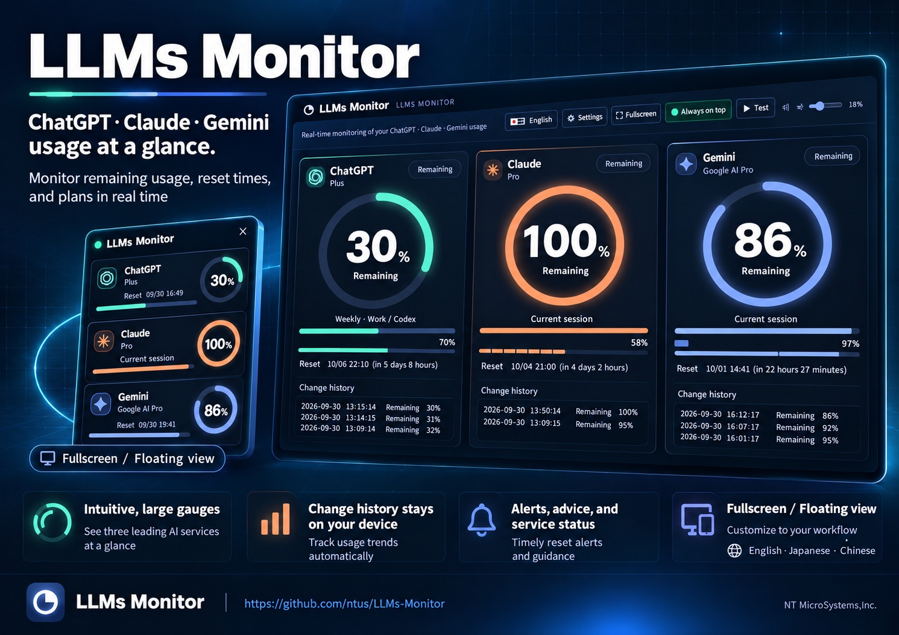
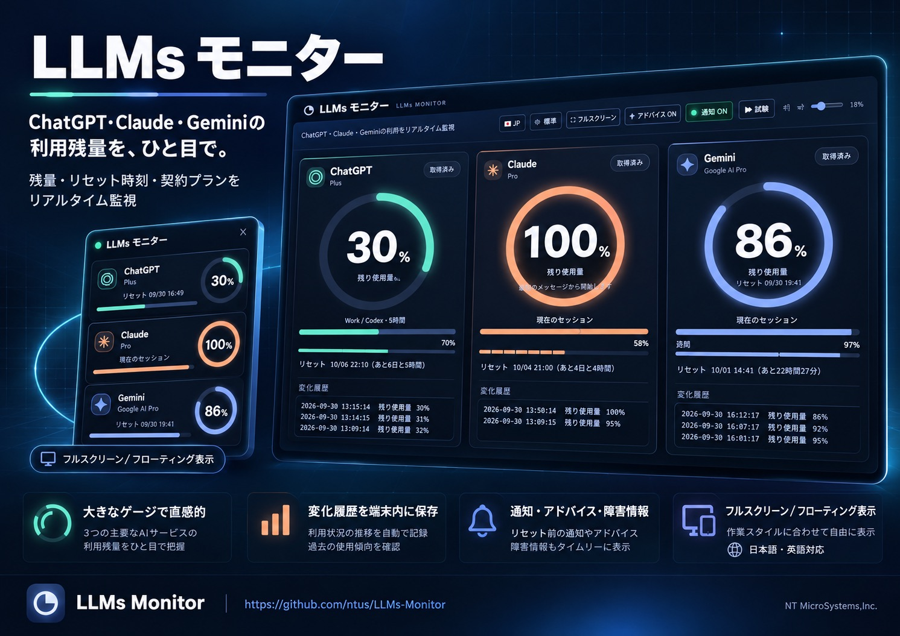

# LLMs Monitor

[Full-size English flyer](assets/promotional/llms-monitor-a4-landscape-flyer-en-v1.jpg?raw=1) · Earlier visual overview; the current guide is below.

**Your AI capacity. Your work, remembered.**

[🌍 EN](#en) · [🇯🇵 JP](#ja)

## v1.32 changes

**A clearer view of AI-driven development.** Capacity, task lists and linked work notes help you resume AI-assisted work.

- ChatGPT status includes **Tibo 𝕏**, an OpenAI staff profile link. It does not activate the currently unconfigured X feed or prove a personal reset.
- **Sound OFF** cancels scheduled tones and late audio resumes. Mute is saved without waiting for quota refresh, and old windows’ other settings cannot turn it back ON. **Preview** plays once without changing ON/OFF. The installed extension still checks usage and service status when the main monitor closes; turn OFF to mute those checks.
- Work-note registration survives worker sleep; actual Claude Code thread headings and editable note titles replace generic titles. Blank workspace means Shared, preserving old `default` notes; manual selections are remembered per provider.
- The **Codex helper ZIP is a native installer**, not the Chrome extension package. Extract it and run `Install.command` on macOS or the command in the [helper guide](native/README.md) on Linux. Chrome **Load unpacked** uses the main extension ZIP’s extracted folder containing `manifest.json`.

Update the extension in place; do not uninstall or clear browser storage. Save official-page drafts before manually reloading them to receive the new registration reader. [Task/work-note details](TASK_DETAILS.md).

Release preparation **Web v1.42.0 / extension v1.42.0** for Chrome/Edge desktop, with English and Japanese interfaces.

- **See LLM usage remaining in real time:** current/weekly limits, reset times, official incidents and local change alerts for ChatGPT, Claude and Gemini.
- **Keep track of work:** independent task windows, evidenced response states, pinned items first, and per-thread notes/checklists with links back to the conversation.

[Open monitor](https://llmsmonitor.ntus.info/) · [Product introduction](https://llmsmonitor.ntus.info/product.html) · [Extension ZIP](dist/LLMs-Monitor-v1.42.0.zip) · [Task/work-note guide](TASK_DETAILS.md) · [Specification](SPECIFICATION.md) · [Privacy](PRIVACY.md) · [Security review](SECURITY_REVIEW.md) · [Release history](CHANGELOG.md)

**Tibo reset alerts are not live on the current static Site.** The detector supports public usage/reset posts from Tibo (`@thsottiaux`, OpenAI staff) and selected company accounts, but requires a separately configured X server, secret, cache and minute cron. Tested synthetic detection is not proof of live delivery. See [setup and live acceptance](server/README.md). Posts are announcements, not confirmation that your individual limit has reset. Nerf Bench is [link-only](https://www.bridgebench.ai/nerf-bench).

## Quick start

1. Sign in to the official LLM services in the same Chrome/Edge profile.
2. Until store approval, extract the extension ZIP and use **Load unpacked** in the extension management page. Store installation without developer mode requires separate Chrome Web Store/Edge Add-ons approval; hosting the ZIP does not complete that process.
3. Open the extension, or open the monitor and enter its 32-character extension ID once. The new domain requires pairing even if the previous Site domain was paired.
4. Keep the browser running. Supported usage and official incidents update approximately once a minute. Browser sleep, throttling and provider reporting delay can postpone updates.
5. **Update in place:** keep the same unpacked folder and extension ID, reload the extension, then reload the monitor. Do not uninstall to update; extension history/settings are retained. Save drafts before manually reloading existing official chats to activate a new registration button.

## Usage and alerts

Gauges and bars show obtained remaining values, with resets and weekly session equivalents when enough local history exists. Unknown values are **—**, failed retrieval retains a labelled previous value, and expired cached windows await a fresh value. Genuine verified exhaustion alone is 0%. ChatGPT Work/Codex limits do not represent ordinary ChatGPT chats. Claude provisional API zero is checked against official usage; missing plans/deadlines are not guessed.

Credits, Claude cloud-session credits, reset entitlements and optional API billing balances are separate. Claude API promotional credit gets its own line. Links open official settings; resets, purchases and account changes are never performed automatically. API billing connections start disabled and require a direct permission click; keep the billing page open. Coverage depends on what that account exposes.

Only changed numeric values blink; local sound is sent before the display change. Tones follow changes to the displayed whole-percent quota only: fractional changes that round to the same number and credit changes are silent. At most three tones, one second apart. Downward crossings into 5% and 1% have distinct gentle warning tones. Provider pacing warnings shown on official usage pages appear in the matching card. Sound defaults on, but browser/OS restrictions can require a first gesture. Official incident checks are separate from X alerts and personal usage.

Use standard/dark themes, language, volume, opacity, service ordering/hiding, fullscreen or a floating view. Hidden services continue acquisition/history. Always-on-top uses supported Document Picture-in-Picture after a click; native window chrome, sizing limits and OS transparency belong to the browser/OS. Floating incident details list only affected services, while usage cards remain available. History stores up to 10,000 changed values per window locally.

For macOS helper setup: **Connect Codex → download and extract → run Install.command → paste the extension ID → Enable connection → Check connection → Refresh list**. The [step-by-step guide](https://github.com/ntus/LLMs-Monitor/blob/main/native/README.md#macos-en) includes a Terminal fallback, Python 3.9+ checks and troubleshooting. Linux has a command installer; Windows helper installation is not implemented. Web v1.42.0 uses helper v1.30.2; the extension ZIP is v1.42.0.

## Tasks and work notes

**Task details** opens a tall separate window titled `LLMs Monitor -Task- ChatGPT` (or Claude/Gemini). Compact bars show that provider’s saved usage and incident without refreshing quotas or modifying the main monitor. Search/filter the list and collapse pins, notes or the tree; all sections start expanded.

Observed states appear before every item. **Generating** means a visible stop control was observed; **Response idle** is not completion. Closed ordinary chats or unrecognized controls stay Unknown. Open-tab evidence expires after 15 seconds; exact Claude Code list evidence and shared Codex evidence after 90 seconds. Waiting cannot be inferred into finished work.

Pinned projects/chats are prioritized when detected. Rendered-list coverage and rejected/limited counts are displayed; **all account pins are not guaranteed**. A pinned project does not pin every child chat. Browser ChatGPT and desktop Codex are different sources. Optional [Codex helper v1.30.1](dist/LLMs-Monitor-Codex-Helper-v1.30.1.zip), [macOS installation guide](https://github.com/ntus/LLMs-Monitor/blob/main/native/README.md#macos-en), provides this computer’s Codex metadata/local pins; it is initially disabled. Runtime stays Unknown unless an existing shared server supplies evidence.

To remember a thread:

1. Click **Register work note** on a supported official conversation, or **Work notes / handoff** on a task item.
2. Choose a workspace/account label. The selected title and validated conversation link are included automatically.
3. Write purpose, current situation, next actions, waiting items, cautions and a checklist; click **Save notes**.
4. Saved titles reopen the conversation; **Edit** is at the right edge. Heading counts follow the selected provider/workspace.
5. **Copy handoff** and paste it into the next chat yourself, or export/import JSON for a deliberate transfer. This is local storage, not automatic cross-chat or cloud sharing. Export a backup before clearing browser/site data; notes differ between site origins/browser profiles.

Automatic lists are memory-only and exclude bodies/drafts/credentials. Explicitly saved notes remain even when the latest sidebar omits that chat. Clear/Demo/import pauses automatic task reading. Manual note state is separate from observed response state. Concurrent edits/import conflicts are rejected rather than silently overwritten.

## Release and build

Full release build: `node --test tests/*.test.cjs tests/*.test.mjs`, then `python3 build.py --package --codex-helper`. This generates the app, extension, optional helper and current Markdown manuals in `dist/docs/`; no PDF manual exists in this repository. `python3 build.py` alone preserves package/manual artifacts. Helper 1.30.1 fixes the shared-socket fallback deadline. Package changes increment the middle version and reset the last digit; Web-only patches increment the last digit.

Security and regression results are in [Security review](SECURITY_REVIEW.md); remaining store/live-account/X acceptance steps are in [Store submission](STORE_SUBMISSION.md). Current Site access stays owner-only. Formal public access and future `aimon.ntus.info` migration are separate release steps. Chrome/Edge desktop are the target; Safari, Firefox, native mobile, Windows Codex helper and complete account inventories are not claimed supported.

---

## v1.36 — Free Tibo public-page reading

In the monitor, choose **Tibo connections**, allow optional `https://x.com/*` access, then keep a signed-in Tibo profile/post open in Chrome. Only rendered public posts by `@thsottiaux` are inspected once per minute; there is no automatic reload, hidden crawl, paid API, credential extraction or DM/input reading. Undisplayed new posts are not discovered. Missing page/access restrictions show unavailable, preserving prior public alerts; first read is silent and later post IDs notify once. No private usage or notes are sent to X.

ChatGPT main and all shared subviews show **Tibo 𝕏 Reset? (YYYYMMDD HH:MM)** only when an announced future deadline can be parsed. Currently explicit “by EOD PST time” is converted from the posting day's fixed UTC−08:00 end (23:59) to the device timezone. It is an approximate deadline, not an exact execution time. Tooltip shows the announcement/timezone; click opens the exact source post. The mark disappears at the deadline. Short announcements without a deadline still enter the feed, but do not receive a dated mark. Personal quota recovery remains unverified until official usage changes.

The server feed remains unconfigured; this optional browser reader does not deploy or use it. Installed-package permission/notification acceptance is pending.

## v1.32の更新

**AI駆動開発を、見通しよく。** 残量・タスク一覧・リンク付き作業メモで、AIと進める作業の続きを把握します。

- ChatGPT障害情報に［Tibo 𝕏］を追加。OpenAIスタッフのプロフィールへのリンクです。現在未設定の速報配信を有効化したり、個人のリセットを確認したりする機能ではありません。
- 通知音OFFは予約済み音・遅れて再開した音も取消し、残量更新を待たず保存します。他の窓の設定保存でONへ戻らないよう対応。［試聴］は一度だけでON/OFFを変更しません。拡張機能はメイン画面を閉じても使用量・障害を監視します。停止音は通知音OFFで設定してください。
- メモ登録は拡張機能処理の休止後も受け渡せます。Claude Codeスレッド名を取得し、メモタイトルを編集可能に。作業領域の空欄は「共通（未指定）」で旧defaultメモを保持し、手動選択をサービス別に記憶します。
- **CodexヘルパーZIPはChrome拡張機能ではなく端末内インストーラー**です。展開してmacOSは `Install.command`、Linuxは[macOS導入手順](https://github.com/ntus/LLMs-Monitor/blob/main/native/README.md#macos-ja)のコマンドを実行します。Chromeの［パッケージ化されていない拡張機能を読み込む］には、本体拡張ZIPを展開した `manifest.json` のあるフォルダーを指定します。

アンインストール／保存領域の消去をせず上書き更新してください。公式会話タブは入力を保存したうえで手動再読込すると新しいメモ登録処理を使えます。[タスク・メモ取説](TASK_DETAILS.md#ja)。

# 日本語 — LLMs モニター

[🌍 EN](#en) · [🇯🇵 JP](#ja)

[日本語チラシを拡大](assets/promotional/llms-monitor-a4-landscape-flyer-v1.jpg?raw=1)（以前の画面紹介。現行の説明は以下）

**AIの残量も、作業の続きも。** 正式リリース準備版 **Web v1.42.0／拡張v1.42.0**。

① **各種LLMの利用残量をリアルタイム表示！** リセット時刻、公式障害情報、数値変化も確認。

② **タスク一覧とスレッドごとの作業メモで、続きの作業を忘れない！** ピン留め優先、観測できた状態、リンク付き備忘録・チェックリストを別窓で表示。

[モニター](https://llmsmonitor.ntus.info/) · [製品紹介](https://llmsmonitor.ntus.info/product.html) · [拡張機能ZIP](dist/LLMs-Monitor-v1.42.0.zip) · [タスク・作業メモ取説](TASK_DETAILS.md#ja) · [詳細仕様](SPECIFICATION.md#ja) · [プライバシー](PRIVACY.md#ja)

**※Tiboリセット通知は現在の静的サイトでは未稼働です。** Tibo氏（`@thsottiaux`、OpenAIスタッフ）・各社公式Xの利用枠／リセット投稿を検知する処理はありますが、別サーバー・X認証Secret・キャッシュ・1分cronが必要です。模擬データでの成功を実投稿の通知成功とは扱いません。[設定と実投稿検証](server/README.md#ja)を参照。告知は個人の残量がリセット済みである証明ではありません。Nerf Benchはリンクのみです。

CodexヘルパーのmacOS導入は **［Codexを接続］→ZIP展開→Install.command実行→拡張機能ID入力→［接続を有効にする］→［接続を確認］→［一覧を更新］**。詳しくは [macOS手順と困ったときの対処](https://github.com/ntus/LLMs-Monitor/blob/main/native/README.md#macos-ja) を参照。Python 3.9以上、ターミナルでの代替手順、Chrome／Edge別IDの注意点も掲載。Linuxはコマンド方式、Windowsヘルパーは未対応です。Web v1.42.0／ヘルパーv1.30.2へ更新、拡張機能ZIPはv1.42.0です。

## 導入・更新

1. 同じChrome／Edgeプロファイルで公式LLMサイトへログイン。
2. ストア審査完了前はZIPを展開し、拡張機能管理画面の［パッケージ化されていない拡張機能を読み込む］で導入。デベロッパーモード不要の配布は別途ストアの承認・公開が必要です。
3. 拡張機能を開くか、Webモニターに32文字の拡張IDを一度登録。旧URLで登録済みでも新ドメインでは接続が必要です。
4. ブラウザー稼働中は残量・公式障害を約1分ごとに確認。省電力・スリープ・公式側の集計で遅延する場合があります。
5. 更新は**同じフォルダー・同じ拡張IDのまま上書き**し、拡張機能とモニターを再読込。更新時にアンインストールしないでください。既存履歴・設定を保持します。公式チャットの新ボタンを有効にする再読込は入力を保存してから手動で行います。

## 残量の見方

現在枠・週間枠の円とバー、リセット時刻、十分な履歴がある場合の推定セッション数を表示。未取得は—、失敗時は前回値、期限切れは再取得待ち。実際に確認された上限到達だけを0%とします。ChatGPTのWork／Codex枠は通常Chatとは別枠。Claudeの暫定API 0%は公式画面と照合し、プラン名や期限を推測しません。

クレジット、Claudeクラウドセッションクレジット、リセット権、任意のAPI残高は区別します。Claude APIのプロモーションクレジットは別行。リンクは公式設定を開き、購入・権利行使・契約変更は自動実行しません。API連携は初期無効で、拡張機能内のクリックによる任意権限許可後、開いている請求画面を読み取ります。

変化した数値だけ点滅し、音を送出してから表示変更します。音はゲージと同じ整数％の残量変化だけが対象で、表示に出ない小数変化やクレジット変化では鳴りません。最大3音・1秒間隔、残量が5％以下／1％以下へ下降した時は別の穏やかな警告音。公式利用状況画面のペース警告は該当カード内に表示します。通知音は初期ONですが、ブラウザー・OSによって初回操作が必要です。公式障害監視、X速報、個人残量は独立しています。

標準／ダーク、日英、音量、透明度、表示サービス・順序、全画面、小窓に対応。非表示サービスも取得・履歴保存を継続。最前面は対応ブラウザーのDocument PiPでクリック後に起動し、外枠のURL表示・サイズ限界・OS透過はブラウザー／OS仕様です。小窓の障害詳細は障害中のサービスだけに絞り、残量カードは維持。変化履歴は枠ごと最大10,000件を端末内に保存します。

## タスクと作業メモ

［タスク詳細］は縦長の独立画面 `LLMs Monitor -Task- Claude` などを開きます。対象LLMの保存済み残量バーと障害をコンパクトに表示し、主画面の取得・履歴・音声は変更しません。ピン留め／作業メモ／タスク一覧全体を折りたたみ可能、初期は全展開です。

各項目の先頭に状態を表示。［応答生成中］は停止ボタンの観測、［応答待機］は完了ではありません。通常会話のタブを閉じると未確認。開いた会話の観測は15秒、Claude Code一覧・共有Codexの観測は90秒で失効します。

検出したピンを優先表示しますが、**アカウント全件は保証しません**。取得数・未対応・上限を表示。プロジェクトのピンは子の全会話のピンではありません。ブラウザーChatGPTとCodexは別経路。[任意ヘルパー](dist/LLMs-Monitor-Codex-Helper-v1.30.1.zip)と[macOS導入手順](https://github.com/ntus/LLMs-Monitor/blob/main/native/README.md#macos-ja)で、この端末のCodex一覧・ローカルピンを取得できます。初期無効で、共有サーバーの根拠がなければ状態は未確認です。

**備忘録を作る手順**

1. 公式会話の［作業メモへ登録］、または一覧項目の［作業メモ・引継ぎ］を押す。
2. 作業領域／アカウント名を選択。タイトルと対応する会話リンクが自動で入ります。
3. 目的、現在の状況、次の作業、確認待ち、再開時の注意、チェックリストを書き、［メモを保存］。
4. 保存済みのタイトルは元の会話を開き、右端の［編集］で再編集。見出し右側に対象サービス・作業領域の件数を表示。
5. ［引継ぎ文をコピー］して次のチャットへ自分で貼り付けるか、JSONを書出し／読込み。自動共有・クラウド同期ではありません。ブラウザー／サイトURLごとの保存なので、消去前や移行時はバックアップを取ります。

自動一覧は本文・入力・認証情報を取得せずメモリー内のみ。明示保存したメモは、最新一覧から会話が消えても残ります。消去／サンプル／JSON読込は自動取得を停止。メモの手動作業状態と観測した応答状態は別扱いです。同時編集・重複読込は黙って上書きせず拒否します。

## ビルド・正式公開

`node --test tests/*.test.cjs tests/*.test.mjs` 後に `python3 build.py --package --codex-helper` で、本体・拡張機能・ヘルパー・現行Markdown取説（`dist/docs/`）を生成。このリポジトリにPDF取説はありません。通常の `python3 build.py` はZIP・取説成果物を維持。ヘルパー本体は待機不具合を修正した1.30.1です。

[セキュリティ精査](SECURITY_REVIEW.md)・[ストア提出手順](STORE_SUBMISSION.md)を参照。現行Sitesの所有者限定公開は維持し、一般公開・ストア承認・実機確認・将来のaimon.ntus.info移行は別の正式公開作業です。Safari／Firefox／ネイティブモバイル／Windows用Codexヘルパー／全アカウント一覧は対応を保証しません。

Documentation-only build / 取説だけのビルド: `python3 build.py --manuals-only CODEX_HELPER.md README.md TASK_DETAILS.md SPECIFICATION.md AGENTS.md` updates only the named hosted manuals; no app/version/ZIP changes.

### 2026-10-12 helper connection fix / ヘルパー接続修正

Use [helper v1.30.1](https://llmsmonitor.ntus.info/LLMs-Monitor-Codex-Helper-v1.30.1.zip), reinstall once with the current browser extension ID, then Check connection. **Refresh list / ［一覧を更新］** is in **LLMs Monitor → ChatGPT card → Task details**, not the official ChatGPT site. The unchanged extension setup links to old helper 1.30.0; the independent task window and updated guide link to 1.30.1. Metadata-only states remain Unknown; installation is not required each refresh.

v1.30.1を一度導入し直して［接続を確認］。その後、**LLMs MonitorのChatGPTカード → ［タスク詳細］ → ［一覧を更新］**。公式ChatGPTにはこの更新ボタンはありません。ヘルパー更新リンクは新しいタスク画面／取説から使います。

Web v1.35.1: ★/☆ favorites from tasks, pins and Codex; drag/keyboard ordering per service/workspace, with existing work notes preserved.
Web v1.35.1：★／☆でお気に入り登録・解除、ドラッグ／上下キーで表示順変更。既存メモ・リンク・本文を保持し、解除したメモも編集できます。拡張機能はv1.35.0のままです。

## v1.36 — 無料のTibo公開ページ読取り

メインの［Tibo連携］から任意の `https://x.com/*` アクセスを許可し、Chromeでログイン済みのTiboプロフィールまたは投稿を開いてください。1分ごとに、画面に表示済みの `@thsottiaux` 本人の公開投稿だけを確認します。自動リロード・裏の巡回・有料API・認証取得・DM／入力欄読取りは行いません。未表示の新着は検知できず、ページなし・アクセス制限は取得不能になります。初回は無音、以後の新しい投稿IDを一度だけ通知します。利用残量・メモをXへ送りません。

予定期限を読み取れる場合だけ、ChatGPTのメインと共通サブ画面に **Tibo 𝕏 Reset? (YYYYMMDD HH:MM)** を表示します。現在は明示的な「by EOD PST time」を、投稿日のPST（固定UTC−08:00）の当日末23:59という目安に解釈し、端末の現地時間へ換算します。正確な実施時刻ではありません。ツールチップで内容・タイムゾーンを確認でき、クリックで当該投稿へ移動、期限後は非表示です。日時のない短文告知は速報に表示しますが日時付きマークを出しません。個人の残量回復は公式使用量の変化で別途確認します。

サーバー配信は引き続き未設定です。この任意ブラウザ経路はサーバー配置・有料API利用をしません。更新済み拡張機能の権限・通知の実機確認は未完了です。

## v1.38 / helper v1.30.2 — simplified connection (2026-10-13)

EN: In Connect Codex, select **Save installer ZIP for this extension**. Extract it, run Install.command on macOS (or `python3 ./install.py` in that folder on macOS/Linux), then select **Connect (enable and check)** and allow the optional native permission. This ZIP includes this extension’s exact ID; no copy or ID input is required. If macOS blocks double-click, use the Python command in the extracted folder. The generic download still asks for an ID. Existing configured connections are checked automatically when setup opens; no installer is needed each refresh. Update an unpacked extension by overwriting the same folder and reloading it to retain its ID. A different installation ID requires a new personalized installer. Windows/iOS/Android remain future targets, not supported by this native helper.

JP: ［Codexを接続］で **［この端末用の導入ZIPを保存］** を押し、展開します。macOSは Install.command、ダブルクリックが拒否された場合やLinuxは展開フォルダーで `python3 ./install.py` を実行。その後 **［接続する（有効化・確認）］** を押して任意権限を許可します。このZIPには現在の拡張機能IDが自動設定され、コピー・入力は不要です。汎用ZIPでは従来どおりID入力が必要です。既存の接続は設定画面を開くと確認され、毎回のインストールは不要。拡張機能更新は同じ展開フォルダーへ上書きして再読み込みしIDを維持します。別のIDで導入した場合だけ専用ZIPを作り直してください。Windows／iOS／Androidのヘルパー対応は今後の要件です。

## v1.45.0 — Setup / 追加連携

Single own top-level setup.html groups required sign-in guidance, optional API/Codex/Tibo and up-to-three service selection. Additional Grok/DeepSeek/Perplexity/Genspark account readers are experimental, disabled by default, exact-route/top-frame validated and separately permissioned. Never read chats, auto-navigate/reload, use paid APIs or convert credit balances to quota percentages. Preserve native exact-ID installation and existing no-window acquisition safeguards. Task helper action opens personalized installation/check, not a generic ZIP. Existing helper and standalone manual files remain unchanged. Live additional-provider layouts and installed automatic Claude billing remain acceptance limits.

日本語：セットアップ画面に任意設定を集約。追加4社は公式残高・契約画面の試験読取りで初期無効、実アカウントの形式は未検証。表示するサービスを選択（v1.58.0以降は3つの上限なし）。Codexは同画面からID入力不要のZIP保存・接続確認。ヘルパーと既存取説配布物は再生成しません。

## v1.46 quick changes / 操作の変更

Use the button after Advice to switch Remaining / Used display; stored history and alerts continue using remaining quota. Turning Sound from OFF to ON plays one preview, replacing the old Test button. Product → Setup now sit together in the header. Open “Stored only in this browser” for the local-storage explanation. Public updates carry publication/read dates and original links; displayed same-author replies are bounded, while unseen replies remain unverified. Enable optional ClaudeDevs reading separately in Setup → Tibo / public posts; keep the relevant public conversation rendered.

アドバイス右のボタンで残量／使用量の表示を切替。保存履歴・通知は残量基準を維持。通知音をOFF→ONで確認音が鳴り、独立した試聴ボタンは廃止。ヘッダーは製品紹介→セットアップの順です。「ブラウザ内だけに保存」を開くと保存範囲の説明が出ます。公開情報は日時・出典付き、本人の表示済み補足だけを扱い未表示の返信は未確認。ClaudeDevsはセットアップで別途任意に有効化します。

### v1.51.0 操作変更
オプションは初期展開。拡張機能メイン画面内でAPI・Codex・公開投稿の接続設定を行えます。Web版の設定操作は同じタブを拡張機能メインへ切り替えます。自動取得タブはメインモニターのある通常ウィンドウ内に限定され、見つからなければ見送ります。音量操作を確定すると変更後の確認音が一度鳴ります。ドラッグしたTipはアプリ内の最前面です。通常のChatGPT Chat残量は取得元未確認のため未対応です。

### v1.52.0
表示数3つの制限を解除し、カード幅を保つ横一列スクロールに対応。Grokは任意設定で公式Usageの明示された週間％を読み取り、履歴へ保存します。公式Usageをログイン済みで開く必要があります。実アカウント形式は確認中で、取得不能な値は推測しません。オプションのAPIパネルは初期表示から展開。拡張機能の再起動は同じタブをWebモニターへ切り替えた後に行います。

Macの更新操作をまとめる場合は [更新ツールの説明](tools/mac-updater/README.md) を参照してください。Codexヘルパーとは別のアプリで、既存の拡張機能フォルダーを初回だけ登録します。
